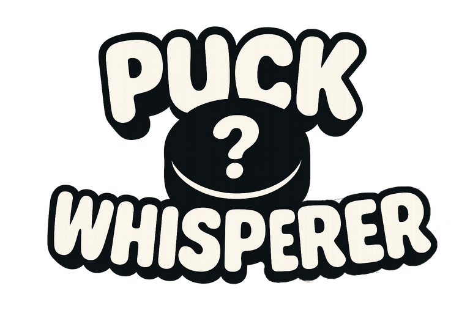
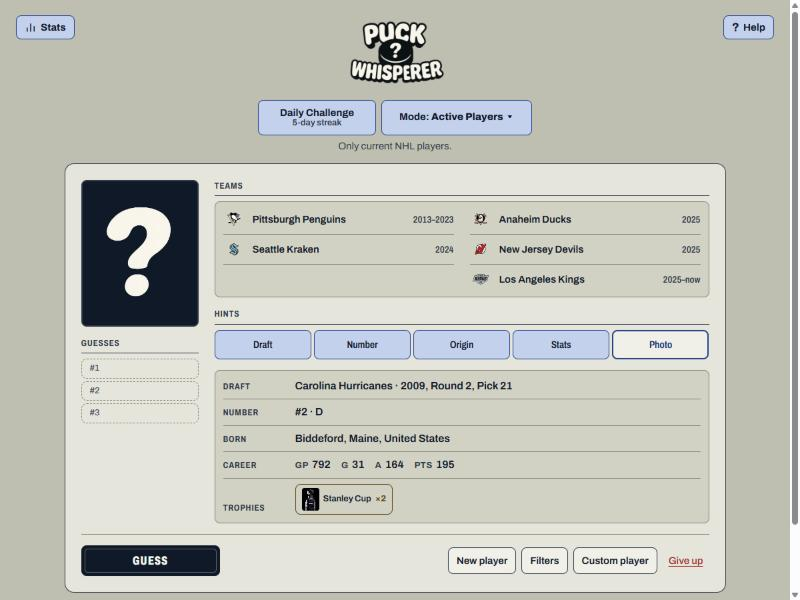
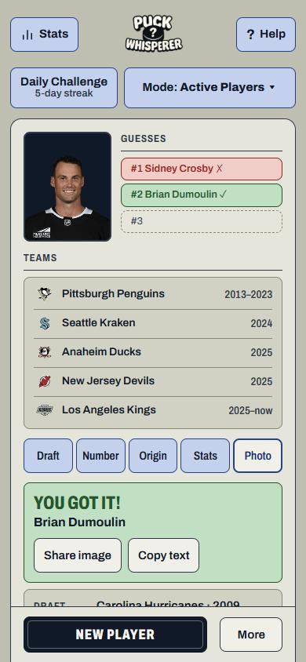

<p align="center">
  
</p>

<h1 align="center">PuckWhisperer</h1>

<p align="center">
  Guess the mystery NHL player in three tries.<br>
  <a href="https://puckwhisperer.app"><strong>Play it at puckwhisperer.app</strong></a>
  &nbsp;·&nbsp;
  <a href="https://x.com/PuckWhisperer_">@PuckWhisperer_</a>
</p>

<p align="center">
  
  &nbsp;
  
</p>

PuckWhisperer is a daily-habit hockey guessing game. The screen is the **back of a hockey card**: you see where a player has been, unlock clues one at a time, and when the round ends the face-down card flips to reveal who it was.

## How it plays

- **Three guesses** to name a mystery NHL player.
- **The career is shown from the start**: every team they played for and the years, as a stat table.
- **Five hints, unlocked in order**: Draft, Number, Origin, Stats (with trophies) and Photo. The Photo hint flips the card face-up.
- **Win, lose or give up** and the card flips to the player's photo, with the result right on the card.
- **Modes** change the pool: Active Players, Modern Era, All Players (hard), Award Winners, The Cup, Hall of Famers, Legends (the NHL's Top 100), 100+ / 500+ / 1,000+ Games, 500 Goal Club, 1,000 Point Club and 300+ Goalie Wins.
- **Filters** narrow any mode by position, jersey number, team, minimum stats and draft year or round. **Custom player** lets you pick the mystery player yourself, for a friend to guess.

### The Daily Challenge

One puzzle a day, the same player for everyone. The date is Eastern time, and the pick comes from active players with at least 100 NHL games. The day's pick is stored the first time anyone asks, so it cannot change under you mid-day. Your streak shows on the button while it is alive and expires honestly if you miss a day.

### Sharing

Finish a round and share it as an **image** (a card-back picture with your score, one square per guess and your streak) or as **text** (`PuckWhisperer 2/3` plus the squares). The image only ever shows the result, never the player's name, so it cannot spoil the answer.

## Built for repeat play

- A round **survives a reload or an app switch**. Daily Challenge progress is saved too, so leaving and coming back cannot hand you a fresh attempt.
- Anything that would throw away a half-played round **asks first**, and a round you leave can be **resumed** until you start the next one.
- Your last mode and filters are remembered. Stats and streaks live **on your device only**.
- **Keyboard**: `1`–`5` unlock hints, `G` guesses, `N` is a new player, `D` opens the Daily Challenge, `Q` gives up (always with a confirm).
- **Phone first**: the whole card fits above the fold for typical players, Guess is pinned to the bottom, and touch targets are at least 44px. Verified from 320px wide up.
- **Accessible**: real dialogs with focus handling, labelled controls, announced results and errors, and reduced-motion support.

## How it fits together

```
NHL public API ──► Scripts (scrape / weekly update) ──► MongoDB
                                                           │
                              Express API (Cloud Run) ◄────┘
                                        │
                        React + Vite frontend (Render) ──► players
```

All player data comes from the NHL's own public API: `api-web.nhle.com` for players and standings, `api.nhle.com/stats` for teams, and `assets.nhle.com` for logos and photos.

| Folder | What lives there |
| --- | --- |
| `Frontend/` | The React 19 + Vite app. `src/App.jsx` is the game, `src/dailyStats.js` holds everything saved on the device, `src/analytics.js` the GA events, `src/shareImage.js` the share-image renderer. |
| `Backend/` | The Express API (`server.js`) and its `Dockerfile` for Cloud Run. |
| `Scripts/` | The NHL scraper and weekly updater, plus `useNHLData.js`, the data hooks the frontend imports. |
| `.github/workflows/` | The weekly job that refreshes active players. |
| `PRODUCT.md` | The product and design record: who it is for, what it is, and the design principles. |

## Run it locally

You need Node 20 or newer (CI uses 22).

### Just the frontend

The app talks to the hosted API, so this is all most changes need:

```bash
cd Frontend
npm install
npm run dev
```

Open the address Vite prints (normally http://localhost:5173). Check your work with:

```bash
npm run lint
npm run build
```

### Your own API and database

The API needs a MongoDB database. Create a `.env` file (it is git-ignored) with:

```
MONGODB_URI=...
DB_NAME=...
COLLECTION_NAME=...
PORT=8080
```

Then:

```bash
npm install                 # at the repo root: installs what the scripts need
node Backend/server.js      # starts the API on PORT
```

To point the frontend at it, change `API_BASE_URL` at the top of `Scripts/useNHLData.js`.

### Loading and refreshing player data

With the same `.env` in place, from the repo root:

```bash
node Scripts/getNHLPlayers.js        # full scrape of every franchise (resumable: progress is kept in MongoDB)
node Scripts/update-players.js active   # refresh active players (the default)
```

`update-players.js` also accepts `all`, `team TOR`, `recent 7`, `name McDavid` and `exact "Connor McDavid"`. A GitHub Action runs `active` every Monday at 09:00 UTC (it needs the `MONGODB_URI`, `DB_NAME` and `COLLECTION_NAME` repository secrets).

## API

| Endpoint | Returns |
| --- | --- |
| `GET /api/players` | Players, filtered by the query parameters below (up to `limit`, default 100) |
| `GET /api/players/random` | One random player matching the same filters |
| `GET /api/players/daily` | Today's Daily Challenge player, with `dailyDate` |
| `GET /api/players/:id` | One player by NHL id |
| `GET /api/search?q=` | Players whose name contains the text (case-insensitive, up to 20 results) |
| `GET /api/teams` | Every team abbreviation and name |

Filter parameters: `position`, `team`, mode flags (`isActive`, `modernEra`, `hasAwards`, `hasCup`, `hallOfFame`, `topAllTime`), minimum stats (`stats.games`, `stats.goals`, `stats.assists`, `stats.points`, `stats.wins`), `sweaterNumber`, `draft.year` and `draft.round`.

## Deployment

The frontend builds with `npm run build` and is hosted on Render. The API is the container in `Backend/Dockerfile`, running on Google Cloud Run. Database credentials are supplied as environment variables and are never committed.

## Analytics and privacy

The site uses Google Analytics with a few events that answer two questions: do people come back, and do they share? `visit` (with days since the last visit), `round_end`, `daily_complete` and `share`. Nothing identifies a person: no names, no answers, no free text. Links in shared text carry `utm_source=share`, so visits that come from shares show up as their own source.

## Disclaimer

PuckWhisperer is not affiliated or associated in any way with the National Hockey League. Use of any logos on this website does not constitute a sponsorship or endorsement by the teams, league, or trademark holders.
